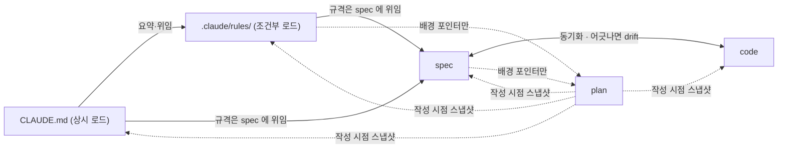

---
paths:
  - "plan.md"
  - "plans/**/*.md"
  - "**/plans/**/*.md"
  - "spec/**/*.md"
  - "**/spec/**/*.md"
  - "CLAUDE.md"
  - "AGENTS.md"
  - "**/CLAUDE.md"
  - "**/.claude/rules/**/*.md"
---

# 문서 의존성 (Spec / Rules / Plan / Code)

각 문서가 무엇인지는 CLAUDE.md의 "문서 계층 (Spec / Rules / Plan)" 절이 정한다. 이 룰은 문서 **사이**의 관계를 정한다 — 누가 누구를 근거로 가리켜도 되는지, 하나가 바뀌면 무엇을 함께 고치는지. 방향이 어긋난 참조는 고치지 않는 문서(plan)를 현재 정책처럼 읽게 만들고, 함께 고칠 곳을 놓치게 한다.

## 참조 방향

| 참조 | 허용 | 조건 |
|---|---|---|
| CLAUDE.md → `.claude/rules/` | ✅ | CLAUDE.md 는 상시 원칙과 요약만 둔다. 상세는 룰 파일이 단일 출처다 |
| rules → spec | ✅ | "현재 규격은 spec" 이라고 위임만 한다. 규격 내용을 rules 에 옮겨 적지 않는다 |
| rules → code | 형태만 | 역할·계약·형태 패턴으로 서술한다. 실제 경로·식별자 스냅샷은 두지 않는다 |
| spec → rules | 경계만 | spec 본문은 rules 없이 읽혀야 한다. 구현 컨벤션은 rules 가 정한다고 가리키는 데서 그친다 |
| spec ↔ code | ✅ | spec 은 소비자가 의존하는 계약, code 는 그 구현이다. `related_paths` 같은 경로 메타데이터는 허용한다 |
| spec·rules → plan | 배경만 | `설계 배경(plan — 시점 기록): <경로>` 형태의 포인터만 둔다. 규범 문장의 근거로 인용하지 않는다 |
| plan → 무엇이든 | ✅ | 작성 시점의 스냅샷으로 인용한다. 대상이 나중에 바뀌어 인용이 깨져도 고치지 않는다 |
| code 주석 → spec·plan | ❌ | 포인터도 복제도 두지 않는다. 계약은 이름·타입·테스트로 드러내고, 정책 근거는 spec 이 말한다 |

## 충돌할 때

- **동작·정책**: spec·code 가 plan 보다 우선한다. spec 과 code 가 서로 다르면 drift 다 — plan 을 판정 근거로 쓰지 말고 spec 또는 code 를 고친다.
- **작업 방식**: rules 가 plan 보다 우선한다.
- **요약과 상세**: CLAUDE.md 의 요약과 룰 파일의 상세가 어긋나면 상세가 맞다. 요약을 고친다.

## 변경 전파

| 바뀐 것 | 함께 고친다 | 고치지 않는다 |
|---|---|---|
| spec (규격 변경) | code | plan |
| code — 계약 변경 | spec | plan |
| code — 계약이 그대로인 리팩토링 | 없음. spec 을 고쳐야 한다면 spec 이 구현 세부에 결합된 신호다 (`related_paths` 경로 갱신은 예외) | spec, plan |
| `.claude/rules/` 상세 | 그 내용을 요약한 CLAUDE.md 문장 | plan |
| CLAUDE.md 원칙 | 그 원칙을 전제로 쓴 rules | plan |
| 새 결정 | 새 plan 을 쓰고, 결과를 spec·rules 에 반영한다 | 기존 plan |
